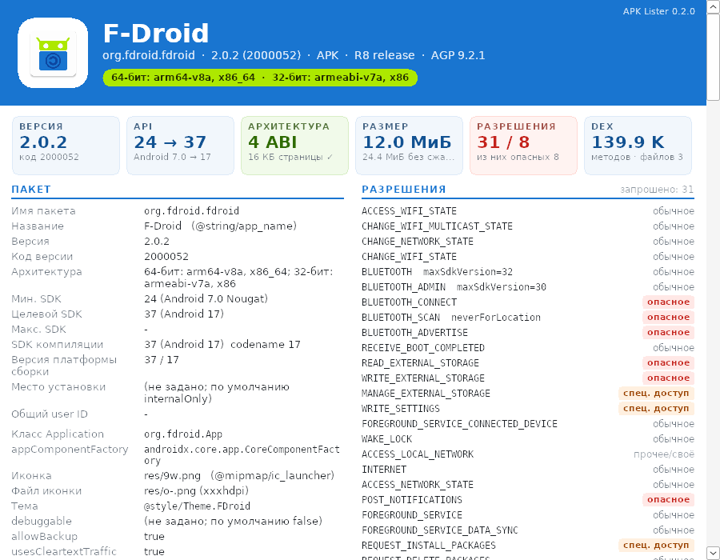

# APK Lister — Total Commander Lister plugin (WLX) for Android packages



[Тёмная тема / dark mode](docs/screenshot-dark.png) · [узкое окно / narrow window](docs/screenshot-narrow.png) · [English](docs/screenshot-en.png)

[Русский](#русский) · [English](#english)

---

## Русский

**APK Lister** — плагин просмотрщика (Lister, F3 / Ctrl+Q) для Total Commander, показывающий максимум технической информации об Android‑пакетах:
`.apk`, `.xapk`, `.apks`, `.apkm`, `.aab` (Android App Bundle) и `.apex`.

Написан на чистом C++/Win32 без внешних зависимостей: собственные парсеры ZIP/zip64, бинарного XML (AXML), `resources.arsc`, protobuf‑манифеста/ресурсов aapt2 (AAB), JSON‑манифестов бандлов, DEX и ELF. Файл отображается в память (memory‑mapped), большие APK открываются за доли секунды.

### Что показывает

Одна страница на русском или английском языке, нарисованная в стиле «Bold» (версия 0.2.0, макет — `design/C.png`):

- **шапка** в цвете иконки приложения (основной цвет определяется по иконке; если иконка серая или её нет — цвет по хешу имени пакета; цвет текста подбирается с контрастом не ниже 4.5:1): иконка на белой плашке, название, строка «пакет · версия (код) · тип · компилятор · AGP» и «таблетка» с **архитектурой** (`64-бит: arm64-v8a, x86_64 · 32-бит: armeabi-v7a, x86`). В правом верхнем углу — версия плагина (`APK Lister 0.2.0`), по ней видно, какую DLL на самом деле загрузил TC;
- **шесть плиток**: версия, API min → target, архитектура (N ABI / «любая» / «в сплитах», с отметкой о 16 КБ страницах), размер, разрешения всего / опасных (красная плитка, если есть опасные), DEX (методы, число файлов);
- ниже — **все секции** текстовой сводки в две колонки (одна колонка, если окно уже 700 px; плитки перестраиваются 6 → 3 → 2). Разрешения, функции, библиотеки показаны полностью, с цветными метками уровня защиты (опасное / спец. доступ / подпись); у разрешений `android.permission.` в списке скрыт (при копировании имя полное). Секции с широкими таблицами (DEX, нативные библиотеки) занимают всю ширину. Секция ФАЙЛ показана последней.

- ФАЙЛ: путь, тип, размер (хеши файла не считаются — открытие мгновенное);
- ПАКЕТ: имя пакета, название (включая локализованные), версия и код версии, **Архитектура** — ABI по разрядности (`64-бит: arm64-v8a, x86_64; 32-бит: armeabi-v7a, x86`). Варианты:
  - `любая (нет нативного кода)` — в APK нет `.so`, приложение работает на любом процессоре;
  - `неизвестно: базовый APK split-приложения…` — это `base.apk` из Play (в манифесте `isSplitRequired` / `requiredSplitTypes` / `com.android.vending.splits`), нативный код лежит в `split_config.<abi>.apk`; откройте XAPK/APKS/APKM целиком;
  - для XAPK/APKS/APKM ABI собираются из config‑сплитов, для AAB — из всех модулей;
  - `.so` вне `lib/` (например, в `assets/`) тоже учитываются — по имени каталога или по ELF‑заголовку;
- далее min/target/max/compile SDK с названиями версий Android, installLocation, sharedUserId, класс Application, иконка, тема и все флаги `<application>` (debuggable, allowBackup, usesCleartextTraffic, networkSecurityConfig, extractNativeLibs, …) с умолчаниями;
- PERMISSIONS с уровнем защиты (dangerous / signature / …), объявленные разрешения, FEATURES;
- meta‑data, uses-library, `<queries>`, прочие элементы манифеста;
- NATIVE LIBRARIES: ABI, размеры, выравнивание ELF‑сегментов (проверка совместимости с 16 KB page size), версия NDK, выравнивание несжатых .so в zip;
- DEX: число классов/методов/полей/строк, версия формата, маркеры R8/D8 (min‑api, режим компиляции), обнаруженные библиотеки;
- FRAMEWORKS & TECHNOLOGIES: Flutter, React Native, Unity, Xamarin/.NET MAUI, Kotlin, Compose, Cordova, протекторы/обфускаторы и т.п.;
- BUILD INFO: версия AGP, `META-INF/*.version`, `*.properties`, информация о VCS;
- RESOURCES: локали, плотности, конфигурации; ZIP STRUCTURE;
- для контейнеров (XAPK/APKS/APKM/AAB): список сплитов с классификацией (base / ABI / язык / плотность / feature), манифест бандла, BundleConfig, затем полный анализ base APK.

Копирование: **Ctrl+A** — выделить всё, **Ctrl+C / Ctrl+Ins** — скопировать выделенные строки (или весь отчёт, если ничего не выделено). Строки выделяются мышью (щелчок, протягивание, Shift+щелчок); правая кнопка — меню «Копировать значение / строку / выделенное / всё». Весь отчёт копируется тем же текстом, что и в 0.1.x (как выводит `apkinfo`). Работает поиск TC (F7 / F3 «найти далее», с учётом регистра, целых слов и обратного направления): совпадение подсвечивается и прокручивается в видимую область. Прокрутка — колесо, PgUp/PgDn, Пробел, Home/End, стрелки. В режиме эскизов (Ctrl+F1) TC показывает иконку приложения.

**Тёмная тема:** по умолчанию следует за Total Commander (флаги тёмного режима TC 10+ при открытии и по `lc_newparams`), для старых версий TC — за настройкой Windows «режим приложений». Принудительно — `Theme=light|dark` в `apklister.ini`.

Поддерживается масштабирование (per‑monitor DPI): шрифты Segoe UI / Consolas, иконка и отступы пересчитываются при переносе окна на монитор с другим DPI.

Подписи и компоненты (activities/services/…) намеренно не показываются, чтобы сводка оставалась компактной.

### Язык

По умолчанию (`auto`) язык берётся из настроек Total Commander (`wincmd.ini`, `[Configuration] LanguageIni`: `WCMD_RUS.LNG` → русский, другой файл → английский), а если TC не задаёт язык — из языка интерфейса Windows. Принудительно: создайте рядом с `apklister.wlx` файл `apklister.ini` (образец — `apklister.ini.sample`) или добавьте секцию в `lsplugin.ini` TC:

```ini
[APKLister]
Language=ru   ; ru | en | auto
Theme=auto    ; auto | light | dark
```

Настройка читается при каждом открытии файла, перезапуск TC не нужен.

### Установка

Откройте в Total Commander архив `apklister-0.2.0.zip` (Enter) — TC предложит установить или обновить плагин по `pluginst.inf` (в нём указана `version=0.2.0`).

**Обновление:** TC держит загруженную DLL плагина до перезапуска. После обновления закройте **все** окна TC и запустите его снова, затем откройте APK по F3 — в правом верхнем углу должно быть `APK Lister 0.2.0` (также видно в последней строке сводки и в свойствах файла `apklister.wlx64` → «Подробно»).
Вручную: *Конфигурация → Настройка → Плагины → Lister (WLX) → Добавить*, выберите `apklister.wlx` (64‑битный TC сам подхватит `apklister.wlx64` из той же папки).

Строка определения: `EXT="APK" | EXT="XAPK" | EXT="APKS" | EXT="APKM" | EXT="AAB" | EXT="APEX"`.

### Клавиши

| Клавиша | Действие |
|---|---|
| Ctrl+A, Ctrl+C, Ctrl+Ins | выделить всё / копировать |
| F7, F3 | поиск средствами TC |
| Esc, 1–7, N/P и остальные | передаются Total Commander (режимы просмотра Lister работают как обычно) |

### Сборка

Нужен mingw‑w64 (кросс‑компиляция под Linux или MSYS2):

```sh
make            # build/apklister.wlx, build/apklister.wlx64, apkinfo.exe, apkinfo32.exe, testhost*.exe
make dist       # build/apklister-0.2.0.zip (wlx, wlx64, pluginst.inf, apklister.ini.sample, README.md, LICENSE)
make native     # build/apkinfo-native — консольная версия анализатора для Linux
make asan       # то же с AddressSanitizer/UBSan (для фаззинга)
```

libgcc/libstdc++ линкуются статически, DLL зависят только от системных библиотек Windows.

### Тестирование

- `apkinfo [-m] [-f] [-a] [--lang ru|en] [--icon out.png] file` — тот же анализатор в консоли (сводка по умолчанию; `-m` — декодированный AndroidManifest.xml, `-f` — список файлов архива).
- `testhost.exe plugin.wlx64 file [search] [--back] [--preview out.bmp] [--size 900x700] [--dark] [--pgdn N] [--copy out.txt] [--shot out.bmp]` (и `testhost32.exe` для `apklister.wlx`) — минимальный хост, имитирующий TC (работает и под Wine): `--size` — размер клиентской области, `--dark` — флаг тёмного режима TC, `--shot` — снимок окна.
- `tools/fuzz.py` — мутационный фаззер для ASan‑сборки.

Результаты сверены с `aapt2 dump badging` на реальных APK (F‑Droid, Termux, Binary Eye, Editor) и на бандлах, сгенерированных bundletool 1.17.2 (`samples/demo.*`).
Большие реальные образцы в репозиторий не включены (их можно скачать с f-droid.org).

### Известные ограничения

- подписи и компоненты не показываются;
- `toc.pb` в APKS не декодируется; зашифрованные APKM не поддерживаются;
- иконки WebP показываются только при наличии WebP‑кодека WIC (Windows 10+); adaptive/vector‑иконки заменяются ближайшим PNG;
- технологии показываются списком «группа — название ← признак», а не «чипами», как в макете; анализ синхронный (APK на 110 МБ открывается ~0.1 с, APK с 20 МБ DEX — ~0.5 с из‑за поиска библиотек в DEX);
- 32‑битная версия не открывает файлы больше ~1.5 ГБ;
- проверено в тестовом хосте под Wine, но ещё не в настоящем Total Commander.

### Лицензия

Предлагается **GPL-2.0-or-later** (см. `LICENSE`) — это предложение, лицензию можно сменить до публикации.

---

## English

**APK Lister** is a Lister (F3 / Ctrl+Q) plugin for Total Commander that shows as much technical information as possible about Android packages:
`.apk`, `.xapk`, `.apks`, `.apkm`, `.aab` (Android App Bundle) and `.apex`.

Pure C++/Win32, no external dependencies: own parsers for ZIP/zip64, binary XML (AXML), `resources.arsc`, aapt2 protobuf manifest/resources (AAB), bundle JSON manifests, DEX and ELF. Files are memory‑mapped; large APKs open in a fraction of a second.

### What it shows

A single owner‑drawn page in English or Russian ("Bold" design, 0.2.0, mockup `design/C.png`): a hero band in the app icon's dominant colour (fallback: a colour from the package name hash; text contrast ≥ 4.5:1) with the icon, name, "package · version (code) · type · compiler · AGP" and an **architecture pill** (`64-bit: arm64-v8a, x86_64 · 32-bit: armeabi-v7a, x86`); six tiles (version, API min → target, architecture, size, permissions total / dangerous, DEX); then all sections of the text report in two columns (one column below 700 px; tiles wrap 6 → 3 → 2), permissions etc. in full with coloured protection‑level tags. The plugin version (`APK Lister 0.2.0`) is shown in the top‑right corner so you can see which DLL TC actually loaded. No file hashes are computed, so files open instantly. Dark mode follows Total Commander (TC 10+ dark‑mode flags), otherwise the Windows app theme; override with `Theme=light|dark`. Per‑monitor DPI aware.

Language: `auto` follows Total Commander (`wincmd.ini [Configuration] LanguageIni`), then the Windows UI language; override with `[APKLister] Language=ru|en|auto` in `apklister.ini` next to the plugin (see `apklister.ini.sample`) or in TC's `lsplugin.ini`.

Sections: package identity, labels (incl. localized), versions, **Architecture** (`64-bit: arm64-v8a, x86_64; 32-bit: armeabi-v7a, x86`; `any (no native code)` when there are no `.so`; `unknown: base APK of a split app…` for a Play `base.apk` whose native code lives in `split_config.<abi>.apk`; bundles aggregate ABIs from config splits / all AAB modules; `.so` outside `lib/` are detected by folder name or ELF header), SDK levels with Android release names, all `<application>` flags with defaults; permissions with protection levels, features; meta‑data, libraries, `<queries>`; native libraries per ABI with 16 KB page‑size alignment check, NDK version, zip alignment; DEX statistics, R8/D8 markers, detected libraries; frameworks (Flutter, React Native, Unity, Xamarin/MAUI, Kotlin, Compose, Cordova, protectors…); build info (AGP version, `META-INF/*.version`, VCS info); resources (locales, densities, configs); ZIP structure. For containers: split list with classification, bundle manifest / BundleConfig, then full analysis of the base APK. Signatures and components are intentionally not shown.

Rows can be selected with the mouse (click, drag, Shift+click); Ctrl+A selects all, Ctrl+C / Ctrl+Ins copies the selected rows or the whole plain‑text report (same text as 0.1.x / `apkinfo`); right‑click menu: copy value / row / selection / all. TC search (F7 / F3, match case, whole words, backwards) highlights and scrolls to the match. Scrolling: wheel, PgUp/PgDn, Space, Home/End, arrows; all other keys (Esc, Lister view modes 1–7, N/P…) go to Total Commander, and thumbnails (app icon) in TC's thumbnail view.

### Install

Open `apklister-0.2.0.zip` in Total Commander and confirm installation/update (uses `pluginst.inf`, `version=0.2.0`). TC keeps a loaded plugin DLL until restart: after updating close all TC windows, start it again and check `APK Lister 0.2.0` in the top‑right corner of the viewer, or add `apklister.wlx` manually under *Configuration → Options → Plugins → Lister (WLX)*.

### Build

```sh
make          # 32/64-bit plugin, apkinfo CLI, test hosts (mingw-w64)
make dist     # release zip
make native   # Linux CLI build;  make asan  # sanitizer build for fuzzing
```

### Testing

`apkinfo` CLI (same analyzer), `testhost.exe` / `testhost32.exe` (minimal TC‑like host, works under Wine), `tools/fuzz.py` (mutation fuzzer). Output cross‑checked against `aapt2`.

### Known limitations

Signatures and components are not shown; `toc.pb` not decoded; encrypted APKM unsupported; WebP icons need a WIC WebP codec; adaptive/vector icons fall back to PNG; technologies are listed as rows rather than the mockup's chips; analysis is synchronous (~0.1 s for a 110 MB APK, ~0.5 s for 20 MB of DEX); 32‑bit build limited to ~1.5 GB files; not yet tested in a real Total Commander.

### License

Proposed: **GPL-2.0-or-later** (see `LICENSE`). This is a proposal and can be changed before publishing.
